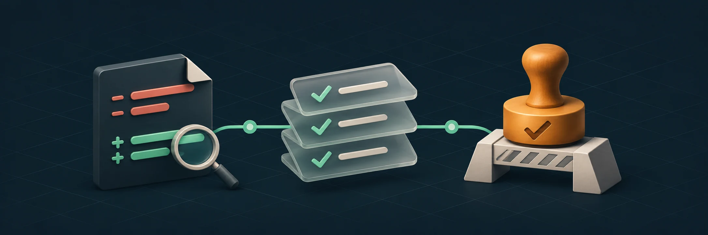
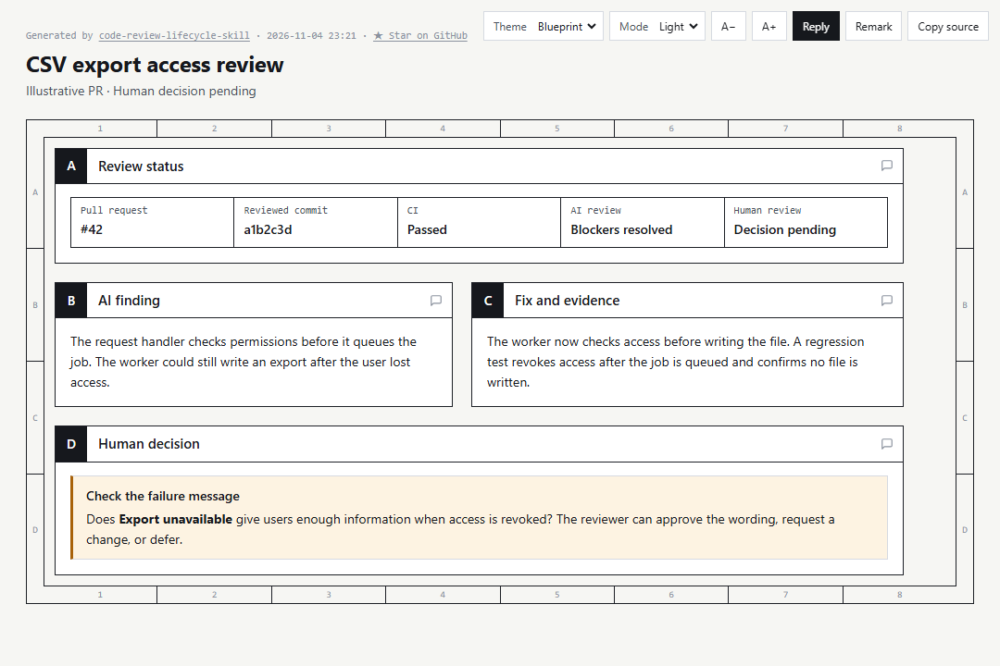

# Code Review Lifecycle

**Review code changes with AI. Give human reviewers the evidence to decide.**

An Agent Skill for Codex, Claude Code, and OpenCode. Ask for a code review and it identifies the local changes or pull request to review.

[📦 Install](#install-and-try-it) · [🔎 See an example](#example-review) · [🧭 Follow the workflow](#workflow) · [📚 Browse the guides](#repository-guide)

[Simplified Chinese](docs/README.zh-CN.md) · [Japanese](docs/README.ja.md)

<p align="center">
  
</p>

## Install and try it

Run this in your project with Node.js 20 or newer and Git. List only the agents you use after `--agent`. Add `--global` to install for your user account.

```sh
npx skills add HoeTee/code-review-lifecycle-skill --agent codex claude-code opencode
```

| Agent | How to start |
| --- | --- |
| Codex | Invoke `$code-review-lifecycle`. |
| Claude Code | Run `/code-review-lifecycle` followed by your request. |
| OpenCode | Ask OpenCode to load `code-review-lifecycle` and describe your task. |

> Use the `code-review-lifecycle` skill to review my changes.

PR and CI operations use your existing repository permissions. The HTML renderer is bundled. [Agent support](references/agent-support.md)

## Example review

A user queues a CSV export, then loses access before the worker runs. The AI reviewer traces the request into the worker and finds that the worker can still generate the file. The author adds a second permission check and a regression test that confirms no file is written after access is revoked.

The reviewer gets a brief with the finding, the checks that ran, and the decision still open. In this example, a person decides whether `Export unavailable` gives users enough information.



*Illustrative PR. The preview was rendered from the [example brief](docs/showcase/export-review.md) with the bundled HTML renderer.*

<details>
<summary>Render the example locally</summary>

```sh
node scripts/render_html.mjs render docs/showcase/export-review.md -o export-review.html --no-open
```

</details>

## Workflow

| Stage | What happens |
| --- | --- |
| **Read review rules** | Read the applicable `CLAUDE.md` and `REVIEW.md` before analyzing the diff. |
| **Identify the change** | Determine the local candidate or PR head and its comparison base. |
| **Review and verify** | Check the diff and affected code. Report findings and the checks that apply to the reviewed version. |
| **Prepare human review** | Summarize the evidence, remaining risks, and decisions for the reviewed PR and commit. |

### AI review and revision

An independent reviewer reads the diff and follows relevant call paths when that capability is available. A finding gives the location, trigger, impact, and a way to verify it. Reviews are read-only by default. When fixes are authorized, re-review the revised changes and their effects.

The cycle ends when no blockers remain and runs for up to three completed review rounds by default. If blockers remain after round three, the agent pauses automated fixes, explains why the approach stalled, and proposes a next step. [PR workflow and AI review](references/pr-workflow.md)

### Human review and the merge decision

The human reviewer sees what changed, key code excerpts, a link to the full diff, the checks that ran, and what still needs judgment. They explicitly approve, request changes, or defer. The decision is recorded against the PR and reviewed commit. Changes that affect the decision go back through the relevant checks and review. [Human review and evidence](references/human-review.md)

The workflow draws on the Claude Code team’s practices for early review, limits on review rounds, and explanations of the code a reviewer needs to understand. [How the Claude Code team does code review](https://claude.dev/blog/solving-code-review-at-anthropic/)

## Repository guide

| Start here | What it covers |
| --- | --- |
| [SKILL.md](SKILL.md) | The shared entry point and how the agent chooses a stage. |
| [Review target and rules](references/review-target.md) and [review rules template](assets/REVIEW.template.md) | See how the skill chooses a diff and applies repository rules. |
| [Verification](references/verification.md) | Choose checks based on the change and its effects. |
| [GitHub](references/platforms/github.md) and [Gitee](references/platforms/gitee.md) | Connect to the platform and inspect PR and CI evidence. |
| [Progress data](assets/progress.example.json) and [validation scenarios](references/validation-scenarios.md) | Try a local snapshot or verify a change to the skill. |

The skill instructions, templates, and reference guides are mainly in Chinese. To render the bundled local progress example, run this from the repository with Python 3 and Node.js 20 or newer.

```sh
python scripts/render_progress.py assets/progress.example.json --output progress-example.html
```

If you change the progress renderer, run `python -m unittest discover -s scripts`.

## License

The project’s own work is licensed under the [MIT License](LICENSE).
