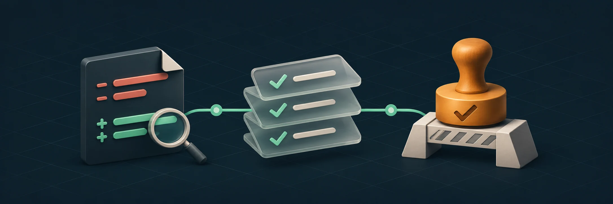
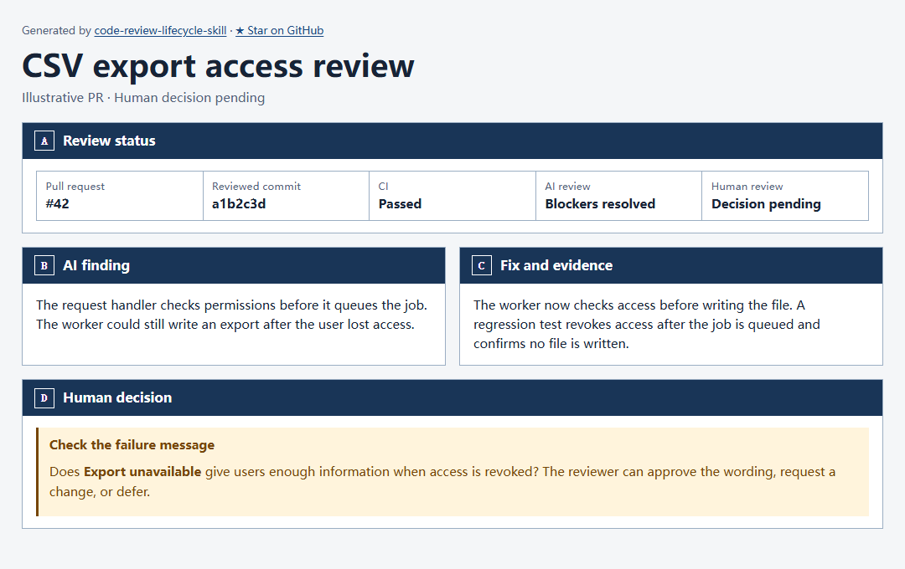

<div align="center">

[English](../README.md) · [简体中文](README.zh-CN.md) · **日本語**

# Code Review Lifecycle

**ローカルの変更から人によるマージ判断まで、AI レビュー、修正、検証を一つの流れに。**

Codex、Claude Code、OpenCode で共通の Agent Skill を使います。

[](https://github.com/HoeTee/code-review-lifecycle-skill/actions/workflows/ci.yml)
[](../references/agent-support.md)
[](../LICENSE)

[使い方](#インストールと使い方) · [流れ](#レビューの流れ) · [機能](#できること) · [例](#例) · [FAQ](#faq) · [資料](#関連資料)

<code>npx skills add HoeTee/code-review-lifecycle-skill</code>

</div>

<p align="center">
  
</p>

コーディングエージェントに変更のレビューを依頼します。エージェントはリポジトリのルールを読み、ローカルの変更や PR を特定し、影響するコードと動作を確認します。修正が許可された場合は、検証と再レビューまで進めます。

人によるレビューには、重要なコード、実際の検証結果、残るリスク、判断事項をまとめます。証拠は、実際に確認した PR とコミットにひも付けます。

## インストールと使い方

プロジェクトのディレクトリで実行します。

```sh
npx skills add HoeTee/code-review-lifecycle-skill --agent codex claude-code opencode
```

[skills インストーラー](https://www.npmjs.com/package/skills) の要件として、Git と Node.js 22.20 以上が必要です。`--agent` の後には使うエージェントだけを残します。ユーザー単位でインストールする場合は `--global` を追加します。

### レビューを依頼する

```text
code-review-lifecycle スキルを使って、変更をレビューしてください。
```

| エージェント | 始め方 |
| --- | --- |
| Codex | `$code-review-lifecycle` を呼び出します。 |
| Claude Code | `/code-review-lifecycle` に続けて依頼を書きます。 |
| OpenCode | `code-review-lifecycle` スキルの読み込みと作業内容を依頼します。 |

ローカルの変更、既存の PR、修正後のコミットから始められます。対象と比較基準はエージェントが特定します。PR と CI の操作には既存のリポジトリ権限を使います。[エージェントの設定と要件](../references/agent-support.md)

## レビューの流れ



*同梱の HTML レンダラーで生成したページのスクリーンショットです。PR #42 とコミット a1b2c3d は説明用の架空の例です。[レビュー資料を読む](showcase/export-review.md)。*

1. **変更をレビューする。** 信頼できるリポジトリルールを読み、対象範囲とバージョンを固定します。AI が影響するコードを確認し、指摘を記録します。
2. **修正して検証する。** 許可を受けて問題を修正し、再レビューします。必須検証を現在のコミットに対応させます。AI レビューはローカルから PR まで、既定で合計最大 3 回です。
3. **人が判断する。** 検証と阻害要因への対応が完了したら、重要なコード、指摘、証拠、リスク、判断事項を示します。人がそのバージョンを承認するか、修正を依頼するか、保留します。

レビューは既定で読み取り専用です。ローカルレビューはレポートの提出で完了できます。PR の書き込みとマージには、それぞれの許可が必要です。CI と AI の結果は人による承認を代行しません。

[対象範囲とルール](../references/review-target.md) · [レビューと修正](../references/pr-workflow.md) · [人によるレビュー](../references/human-review.md)

Claude Code チームの早期レビュー、レビュー回数の上限、重要なコードの解説を参考にしています。[Claude Code チームのコードレビュー](https://claude.dev/blog/solving-code-review-at-anthropic/)

## できること

| 機能 | 得られる結果 |
| --- | --- |
| 対象範囲の自動特定 | ローカルの候補や既存の PR、確認済みの基準、関連する新規ファイル。 |
| 呼び出し経路と影響の分析 | 入力、共有インターフェース、状態変更、下流の利用側、失敗の伝播の確認。 |
| 独立した AI レビュー | 対応する環境では別のコンテキストで指摘を確認し、発生条件、影響、証拠を提示。 |
| 動作に基づく検証 | 関連する単体、API、統合、E2E、ビルド、実タスクの検証と、実際の結果や制限。 |
| 修正後の再レビュー | 修正したコードに対する元の指摘、関連する影響、有効な証拠の確認。 |
| PR と CI の証拠 | 対象コミットと実際の修正に対応する検証結果や議論の状態。 |
| 人に向けたコードの説明 | 変更が必要な理由、判断に必要なコード、人が決めるべき事項。 |
| レビューの進捗 | 対象バージョン、段階、証拠、阻害要因、次の作業を記録する HTML レポート。 |

製品の UI は要件に応じてスクリーンショットで確認できます。生成した説明ページとレビューレポートは内容とリンクを確認し、スクリーンショットによる検証は行いません。

## 例

### エクスポートの待機中にアクセス権が失われる

利用者が CSV エクスポートを依頼した後、Worker が実行する前にアクセス権を失います。レビュアーがリクエストから Worker までを調べ、権限がなくてもファイルを生成できる問題を見つけます。

修正の許可を受けた作成者が実行時の権限確認と回帰テストを追加します。再レビューで権限取り消し後にファイルを生成しないことと、対象コミットの CI を確認します。`Export unavailable` という表示で結果を理解できるかは、人が判断します。

[レビュー資料を読む](showcase/export-review.md)。

<details>
<summary><strong>例のページをローカルで生成する</strong></summary>

このリポジトリをクローンしたディレクトリで実行します。

```sh
node scripts/render_html.mjs render docs/showcase/export-review.md -o export-review.html --no-open
```

</details>

## FAQ

<details>
<summary><strong>インストールするとレビューが自動で始まりますか？</strong></summary>

コーディングエージェントにスキルの使用を依頼します。同梱内容は指示、参照資料、テンプレート、レポートレンダラーです。無人実行には、トリガーとエージェントの実行環境を別途設定します。

</details>

<details>
<summary><strong>別のモデルやレビューサービスが必要ですか？</strong></summary>

現在のエージェントのツールとレビュー機能を使います。独立したレビューには、作成者とは別のコンテキストが必要です。対応しない場合は制限を記録し、作成者による自己確認と区別します。

</details>

<details>
<summary><strong>コードの変更や GitHub へのプッシュを行いますか？</strong></summary>

レビューは既定で読み取り専用です。修正、PR 更新、その他の書き込みを許可できます。各操作は、その許可とリポジトリの権限の範囲内で行います。

</details>

<details>
<summary><strong>CI が成功すれば人による承認も完了しますか？</strong></summary>

CI、AI レビュー、人による判断は別々に記録します。必須検証を通過し、プラットフォームが求める承認は資格のある人が行います。判断はレビュー済みのバージョンに適用します。

</details>

<details>
<summary><strong>どこで動作し、どのツールが必要ですか？</strong></summary>

スキルはコーディングエージェントとそのツールで動作します。変更の特定には Git、リモートの PR と CI にはプラットフォーム認証が必要です。同梱の HTML レンダラーは Node.js 20 以上で動作し、上記のインストール環境でも実行できます。進捗スナップショットの生成には Python 3 も必要です。

スキル本体と参照資料は主に中国語です。README は英語、中国語、日本語で提供します。

</details>

## 関連資料

| 資料 | 用途 |
| --- | --- |
| [SKILL.md](../SKILL.md) と [対応エージェント](../references/agent-support.md) | 共通の入口、呼び出し方、ホストの要件。 |
| [対象範囲とルール](../references/review-target.md) と [レビューテンプレート](../assets/REVIEW.template.md) | 差分の選択とリポジトリルールの適用。 |
| [レビューと修正](../references/pr-workflow.md) と [人によるレビュー](../references/human-review.md) | 指摘、修正、再レビュー、人による判断。 |
| [検証方法](../references/verification.md) | 変更と影響に基づく検証の選択。 |
| [進捗レポート](../references/progress-interaction.md) と [証拠の再利用](../references/execution-efficiency.md) | レビューの追跡と有効な証拠の保持。 |
| [GitHub](../references/platforms/github.md) と [Gitee](../references/platforms/gitee.md) | プラットフォームへの接続と PR、CI の確認。 |
| [進捗の例](../assets/progress.example.json) と [検証シナリオ](../references/validation-scenarios.md) | スナップショットの試行とスキル変更の確認。 |

<details>
<summary><strong>進捗の例を生成する、または検証を実行する</strong></summary>

このリポジトリをクローンしたディレクトリで実行します。

```sh
python scripts/render_progress.py assets/progress.example.json --output progress-example.html
python -B -m unittest discover -s scripts -v
```

GitHub Actions は、PR と `main` へのプッシュに対して同じテストを実行します。進捗の証拠、HTML 生成、パネル更新、同梱レンダラーの整合性を確認します。

</details>

## フィードバックと貢献

見逃し、誤検出、不明確な指示があれば、[Issue](https://github.com/HoeTee/code-review-lifecycle-skill/issues) にエージェント、対象バージョン、依頼、最小の再現手順や期待結果を添えて報告できます。

指示、例、テスト、翻訳の改善は [PR](https://github.com/HoeTee/code-review-lifecycle-skill/pulls) で受け付けます。

## ライセンス

このプロジェクト独自の成果物には [MIT License](../LICENSE) を適用します。
