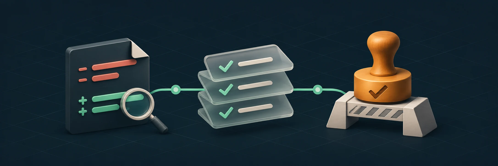
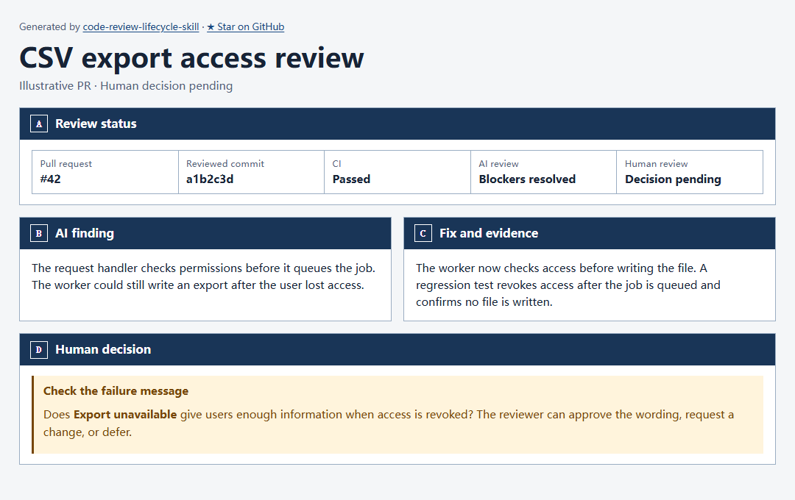

<div align="center">

[English](../README.md) · **简体中文** · [日本語](README.ja.md)

# Code Review Lifecycle

**从本地改动到人工合并决定，让 AI 审查、返修和验证连成一条流程。**

Codex、Claude Code 和 OpenCode 共用一份 Agent Skill。

[](https://github.com/HoeTee/code-review-lifecycle-skill/actions/workflows/ci.yml)
[](../references/agent-support.md)
[](../LICENSE)

[快速开始](#安装与试用) · [审查流程](#审查流程) · [能力](#能做什么) · [示例](#示例) · [常见问题](#常见问题) · [资料](#进一步了解)

<code>npx skills add HoeTee/code-review-lifecycle-skill</code>

</div>

<p align="center">
  
</p>

让 coding agent 审查一次改动。它先读取仓库规则，识别本地改动或已有 PR，再检查受影响的代码和行为。获得返修授权后，继续跟进修复、验证与复审。

人工审核者看到关键代码、实际检查结果、剩余风险和明确的待决定项。每份证据都对应它实际检查的 PR 和提交。

## 安装与试用

在项目目录运行：

```sh
npx skills add HoeTee/code-review-lifecycle-skill --agent codex claude-code opencode
```

需要 Git 和 Node.js 22.20 或更新版本，以满足 [skills 安装器](https://www.npmjs.com/package/skills) 要求。`--agent` 后只保留使用的 Agent。添加 `--global` 可安装到用户范围。

### 发起一次审查

```text
使用 code-review-lifecycle skill，做下 code review。
```

| Agent | 如何开始 |
| --- | --- |
| Codex | 调用 `$code-review-lifecycle`。 |
| Claude Code | 输入 `/code-review-lifecycle`，随后写明请求。 |
| OpenCode | 请它加载 `code-review-lifecycle` skill，再说明任务。 |

可以从本地改动、已有 PR 或返修后的提交开始。Agent 自动确定待审对象与比较基线。PR 和 CI 操作沿用现有仓库权限。[Agent 接入与要求](../references/agent-support.md)

## 审查流程

**发起审查 → 读取可信规则 → 确定改动 → AI 审查 ↔ 获准返修 → PR 检查 → 人工决定 → 合并交接。**

可以从本地改动或已有 PR 开始。只要求本地审查时，交付审查报告即可。创建 PR、更新 PR 和合并都需要对应授权。

下面的 YAML 描述 Agent 的工作流程。实际指令由 [SKILL.md](../SKILL.md) 和相关资料提供；这段内容不是可执行的 GitHub Actions 配置。

```yaml
workflow:
  trigger: "请 Agent 审查一次改动或 PR"
  default_mode: read_only
  max_ai_review_rounds: 3  # 本地审查到 PR 合计三轮。

  stages:
    - id: read_rules
      owner: agent
      action: "读取可信的 CLAUDE.md、REVIEW.md 及引用规则"
      if_root_rules_missing: "给出缺失根规则的草案，写入前请用户确认；独立检查继续"
      if_references_missing: "报告缺失路径和受影响的检查"

    - id: identify_change
      owner: agent
      action: "选择本地改动或 PR，固定基线和受审版本"
      local_scope: "纳入本次范围内的已提交、暂存、未暂存和未跟踪改动"
      pr_scope: "审查固定的 PR head，本地额外改动另列"

    - id: ai_review
      owner: independent_reviewer_when_available
      action: "检查完整 diff、受影响调用方、失败路径和可用检查"
      output: "已核实的 P0/P1/P2 发现、证据和未解决数量"

    - id: resolve_findings
      owner: author_or_authorized_agent
      with_fix_authorization: "修复确认的问题，复跑检查，再回到 ai_review"
      without_fix_authorization: "报告发现和阻断项，不修改代码"
      on_repeated_failure: "两次修复依赖同一前提且同一检查仍失败时，先验证该前提"
      after_round_three_with_blockers: "停止自动返修，分析原因并提出方案"
      if_local_only: "交付报告及已获准的修复，无需创建 PR"

    - id: pr_checks
      owner: agent_and_ci
      when: "已有 PR，或用户要求并授权交付 PR"
      action: "仅按授权创建或更新 PR，将 CI 和线程对应到 base/head"
      on_new_code: "回到 ai_review，仍沿用合计三轮的限制"
      on_failed_or_missing_checks: "在授权内处理，无法完成则报告阻断"
      ready_when: "必需检查通过、证据充分且没有剩余阻断项"

    - id: human_review
      owner: human
      requires: "已有 PR，且满足上面的 ready_when 条件"
      input: "确切提交、P0/P1/P2 摘要、关键代码、证据、风险和待决定项"
      approve: "记录针对受审版本的人工通过结论"
      request_changes: "在剩余轮次内，回到已获准的返修和复审"
      defer: "等待人工决定，保留证据"

    - id: merge_handoff
      owner: authorized_merger
      requires: "人工通过、检查通过、满足仓库规则，并有合并授权"
      on_changed_version: "重做受影响的检查和审查，重新确认受影响的人工决定"
      result: "获准后合并，或交接并说明剩余合并条件"
```

每次返回 AI 审查都沿用原轮次。创建 PR、切换方法或恢复会话不重置计数。超过上限前停止自动循环，给出具体方案供决定。CI 重试不另算一轮审查。

已有 PR 的 CI 与 AI 审查可以并行。审查时读取已有 CI 证据，最终 PR 检查再确认必需结果对应交给人审核的版本。缺少独立审查能力时，如实标明限制。

[审查范围与可信规则](../references/review-target.md) · [缺失规则草案](../references/review-rules.md) · [审查与返修](../references/pr-workflow.md) · [人工审核与 P0/P1/P2](../references/human-review.md)

流程参考 Claude Code 团队的早期审查、有限轮次和关键代码解释做法。[Claude Code 团队的代码审查实践](https://claude.dev/blog/solving-code-review-at-anthropic/)

## 能做什么

| 能力 | 你能获得什么 |
| --- | --- |
| 自动确定审查范围 | 本地候选或已有 PR、确认的基线，以及纳入审查的相关新文件。 |
| 调用链与影响分析 | 输入、共享接口、状态变化、下游消费方和失败传播的检查结果。 |
| 独立 AI 审查 | 能力可用时，由独立上下文核实发现，写明触发条件、后果和证据。 |
| 按行为选择验证 | 相关单元、接口、集成、端到端、构建和真实任务检查，以及实际结果与限制。 |
| 返修后复审 | 对照新版本核对原发现、相关影响和仍有效的证据。 |
| PR 与 CI 证据 | 对应当前受审提交及实际修复的检查结果和讨论状态。 |
| 面向人的代码解释 | 为什么改、哪些代码影响判断、哪些问题需要人决定。 |
| 审查进度 | 可复用的 HTML 报告，记录版本、阶段、证据、卡点和下一步。 |

产品界面可按要求截图验证。生成的说明页和审查报告核对内容与链接，不做截图验收。

## 示例

### 导出任务等待执行时，用户权限被撤回

用户提交 CSV 导出后，在 Worker 执行前失去访问权限。审查者沿请求追到 Worker，发现它仍能生成文件。

获准返修后，作者补上执行时的权限检查和回归测试。复审确认权限撤回后不会生成文件，并核对对应提交的 CI。人再判断 `Export unavailable` 是否解释清楚了结果。



*这是说明流程的虚构案例。[查看示例材料](showcase/export-review.md)。*

<details>
<summary><strong>在本地生成示例页面</strong></summary>

在本仓库的克隆目录运行：

```sh
node scripts/render_html.mjs render docs/showcase/export-review.md -o export-review.html --no-open
```

</details>

## 常见问题

<details>
<summary><strong>安装后会自动开始审查吗？</strong></summary>

需要向 coding agent 发起请求。随包内容包括指令、参考资料、模板和报告渲染器。无人值守的审查需要另行配置触发器和 Agent 执行入口。

</details>

<details>
<summary><strong>需要再配置模型或审查服务吗？</strong></summary>

使用当前 coding agent 的工具与审查能力。独立审查需要与作者分开的上下文。能力不可用时，如实报告限制，并区分作者自检与独立审查。

</details>

<details>
<summary><strong>会修改代码或推送 GitHub 吗？</strong></summary>

默认只读。你可以授权修复、更新 PR 或其他写入。每项操作都受对应授权和仓库权限约束。

</details>

<details>
<summary><strong>CI 通过就等于人工批准吗？</strong></summary>

CI、AI 审查和人工决定分别记录。必需检查需要通过，平台要求的人工审批由有资格的人完成。结论只适用于已审核版本。

</details>

<details>
<summary><strong>在哪里运行，需要哪些工具？</strong></summary>

Skill 由 coding agent 使用现有工具执行。Git 用于识别改动，远端 PR 和 CI 需要平台认证。随包 HTML 渲染器需要 Node.js 20 或更新版本，上述安装环境也能运行。渲染进度快照另需 Python 3。

Skill 正文和参考资料主要为中文。README 提供英文、中文和日文版。

</details>

## 进一步了解

| 资料 | 用途 |
| --- | --- |
| [SKILL.md](../SKILL.md) 与 [Agent 支持](../references/agent-support.md) | 共享入口、调用方式与宿主要求。 |
| [审查范围与规则](../references/review-target.md) 与 [审核模板](../assets/REVIEW.template.md) | 怎样选取 diff、应用仓库规则。 |
| [审查与返修](../references/pr-workflow.md) 与 [人工审核](../references/human-review.md) | 跟进发现、修复、复审和人工决定。 |
| [验证方法](../references/verification.md) | 从行为变化与影响选择检查。 |
| [进度报告](../references/progress-interaction.md) 与 [证据复用](../references/execution-efficiency.md) | 跟踪审查，保留仍有效的证据。 |
| [GitHub](../references/platforms/github.md) 与 [Gitee](../references/platforms/gitee.md) | 接入平台并核对 PR 和 CI。 |
| [进度样例](../assets/progress.example.json) 与 [验证场景](../references/validation-scenarios.md) | 试跑快照或检查 Skill 修改。 |

<details>
<summary><strong>渲染进度样例或运行检查</strong></summary>

在本仓库的克隆目录运行：

```sh
python scripts/render_progress.py assets/progress.example.json --output progress-example.html
python -B -m unittest discover -s scripts -v
```

GitHub Actions 对 PR 和推送到 `main` 的提交运行同一组测试，检查进度证据、HTML 渲染、面板更新和随包渲染器完整性。

</details>

## 反馈与贡献

发现漏检、误报或指令不清楚？可以[提交 Issue](https://github.com/HoeTee/code-review-lifecycle-skill/issues)，附上所用 Agent、受审版本、请求，以及最小复现或预期结果。

指令、示例、测试和翻译的改进可以通过 [PR](https://github.com/HoeTee/code-review-lifecycle-skill/pulls) 提交。

## 许可证

项目自身的工作采用 [MIT License](../LICENSE)。
